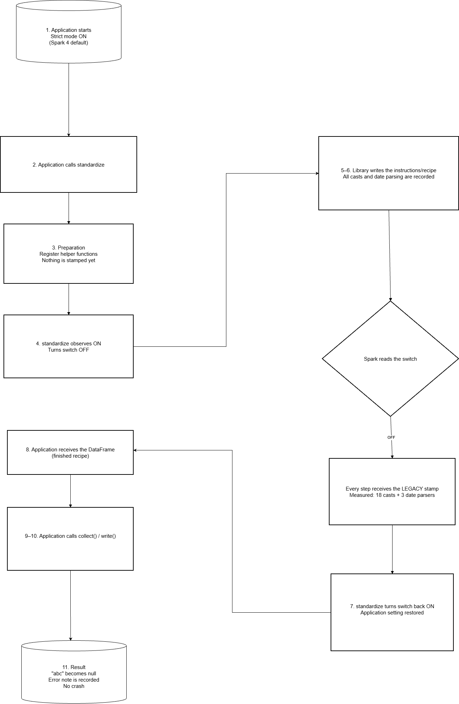

# Context

Standardization library converts raw input into a target schema. Its central rule is **a bad value must not
fail the job**. It becomes `null` in the output column plus an entry in `errCol`:

```
stdCastError, E00000, "Cast from 'string' to 'integer'", num, [abc]
```

The library implements this by casting and then checking for `null` in the result (see `TypeParser`). That only works
if Spark's casts and parse functions **return `null` on failure**, which is Spark's *legacy* (non-ANSI) behaviour.

the library emits these ANSI-sensitive constructs on (`src/main/scala/.../stages/TypeParser.scala`,
`InfinitySupportIso.scala`):

| Construct | Example in library | Spark expression | Where the ANSI flag lives |
|---|---|---|---|
| `Column.cast(dt)` | every type conversion in `TypeParser` | `Cast` | `Cast.evalMode` |
| `to_date(col, pattern)` | `TypeParser.scala:628,630,636,662` | `ParseToDate` → `Cast(GetTimestamp(...))` | `ParseToDate.ansiEnabled` |
| `to_timestamp(col, pattern)` | `TypeParser.scala:684,723` | `ParseToTimestamp` / `GetTimestamp` | `failOnError` |
| `unix_timestamp(col, pattern)` | `TypeParser.scala:699` | `UnixTimestamp` | `failOnError` |
| `col % 1.0` | `TypeParser.scala:399` | `Remainder` | `evalContext` |


##  What changed in Spark 4: ANSI is on by default

`spark.sql.ansi.enabled` default value:

| Version | Source | Default |
|---|---|---|
| 3.5.7 | `spark-catalyst` `org/apache/spark/sql/internal/SQLConf.scala:3198-3207` | `sys.env.get("SPARK_ANSI_SQL_MODE").contains("true")` → **false** unless env var set |
| 4.1.2 | `spark-catalyst` `org/apache/spark/sql/internal/SQLConf.scala:4529-4538` | `!sys.env.get("SPARK_ANSI_SQL_MODE").contains("false")` → **true** unless env var set |

The extract from config doc https://spark.apache.org/docs/4.1.2/sql-ref-ansi-compliance.html:
> *"When true ... Spark will throw an exception at runtime instead of returning null results when the inputs to a SQL
> operator/function are invalid."*


### Observed effect (with ANSI on)

`standardize(...).collect()` gives the
following :

| Input | Spark 4.1.2 | Spark 3.5.7 (ANSI explicitly on) |
|---|---|---|
| `"abc"` → int | `SparkNumberFormatException: [CAST_INVALID_INPUT] The value 'abc' of the type "STRING" cannot be cast to "INT" because it is malformed. ... SQLSTATE: 22018` | same error class |
| `"2147483648"` → int (overflow) | `SparkNumberFormatException: [CAST_INVALID_INPUT] The value '2147483648' ...` | same |
| `"not-a-date"` → date (`yyyy-MM-dd`) | `SparkDateTimeException: [CANNOT_PARSE_TIMESTAMP] Text 'not-a-date' could not be parsed at index 0. Use \`try_to_date\` ... SQLSTATE: 22007` | same, but the message ends with *"If necessary set "spark.sql.ansi.enabled" to "false" to bypass this error."* |


**Test data :**
```
=== standardizationSpark41 
spark=4.1.2 case=invalid  -> org.apache.spark.SparkNumberFormatException: [CAST_INVALID_INPUT] The value 'abc' of the
                             type "STRING" cannot be cast to "INT" because it is malformed. Correct the value as per the
                             syntax, or change its target type. Use `try_cast` to tolerate malformed input and return
                             NULL instead. SQLSTATE: 22018
spark=4.1.2 case=overflow -> org.apache.spark.SparkNumberFormatException: [CAST_INVALID_INPUT] The value '2147483648' of
                             the type "STRING" cannot be cast to "INT" because it is malformed. ...
spark=4.1.2 case=baddate  -> org.apache.spark.SparkDateTimeException: [CANNOT_PARSE_TIMESTAMP] Text 'not-a-date' could
                             not be parsed at index 0. Use `try_to_date` to tolerate invalid input string and return
                             NULL instead. SQLSTATE: 22007
- invalid values, overflows and unparseable dates become errors ... *** FAILED ***
  org.apache.spark.SparkNumberFormatException: [CAST_INVALID_INPUT] The value 'abc' ...
- overlapping standardizations on a shared session ... *** FAILED ***
  java.util.concurrent.ExecutionException: org.apache.spark.SparkNumberFormatException: [CAST_INVALID_INPUT] ...

=== standardization2_12Spark35
spark=3.5.7 case=invalid  -> org.apache.spark.SparkNumberFormatException: [CAST_INVALID_INPUT] The value 'abc' ...
                             ... If necessary set "spark.sql.ansi.enabled" to "false" to bypass this error.
spark=3.5.7 case=overflow -> org.apache.spark.SparkNumberFormatException: [CAST_INVALID_INPUT] The value '2147483648' ...
spark=3.5.7 case=baddate  -> org.apache.spark.SparkDateTimeException: [CANNOT_PARSE_TIMESTAMP] Text 'not-a-date' could
                             not be parsed at index 0. If necessary set "spark.sql.ansi.enabled" to "false" to bypass
                             this error.
- invalid values, overflows and unparseable dates become errors ... *** FAILED ***
- overlapping standardizations on a shared session ... *** FAILED ***
```
**See file:** `src/test/scala/za/co/absa/standardization/StandardizationAnsiModeSuite.scala`

Without any handling, **upgrading to Spark 4 with default settings would see the first malformed record
kill the job** instead of being reported in `errCol` . Spark 3.5's error output recommends turning ANSI off. Spark 4
dropped the hint, but the mechanism is the same.

---
#  Solution design: `withNonAnsiCasts` / `NonAnsiScope`

**See file:** `src/main/scala/za/co/absa/standardization/Standardization.scala`
(`standardize` at line 34, wrapper call at line 42, `withNonAnsiCasts` at line 83, `NonAnsiScope` at lines 89-115)

## 1. How its applied

```scala
def standardize(df, schema, config)(implicit sparkSession): DataFrame = {
  udfLib.register(sparkSession)
  ...
  withNonAnsiCasts(sparkSession) {
    validateSchemaAgainstSelfInconsistencies(schema)   // step 1
    val std = standardizeDataset(df, schema, config)   // step 2: builds every cast / to_date / % ... (df.select)
    val cleanedStd = cleanTheFinalErrorColumn(std)     // step 3
    ... RecordIdGeneration ...                         // optional id column
    idedStd                                            // ← the returned DataFrame: plan already analysed
  }
}
```

This covers **all** plan construction done by the library, from the first `Column` built to the last
`Dataset` created. Each `select` / `withColumn` creates a new Dataset, and in Spark Classic that eagerly analyses
it.

## 2. Implementation 
| Design                                                   | Reason                                                                                                                                                                                                                           |
|----------------------------------------------------------|----------------------------------------------------------------------------------------------------------------------------------------------------------------------------------------------------------------------------------|
| Change the **session** conf (`spark.conf.set`)           | Found as the only place Spark 4.1 Classic reads the cast mode from (`SparkSession.scala:882`, `columnNodeSupport.scala:47`).                                                                                                     |
| **Reference count** per session                          | Overlapping calls share one ANSI-off window, doesn't restore while another call is still planning, and the original value is captured exactly once.                                                                              |
| `IdentityHashMap[SparkSession, State]`                   | Sessions are keyed by **identity**, so two distinct sessions sharing a `SparkContext` get independent windows. The entry is removed as soon as the count hits 0, so sessions are never retained (avoiding potetial memory leak). |
| One `synchronized` monitor, held only for `enter`/`exit` | Planning (`body`) runs **outside** the lock, so concurrent standardizations still plan in parallel.                                                                                                                              |
| `getOption` + `unset` when absent                        | If the caller never set the key, we restore "not set", so Spark keeps using its built-in default (and any future default change). We don't freeze an explicit value.                                                             |
| `try/finally`                                            | Restores even if schema validation throws `ValidationException` or plan analysis fails.                                                                                                                                          |
| Private, no public API change                            | Callers don't need to change anything.                                                                                                                                                                                           |


# Outcome

The returned DataFrame produces null + errCol for invalid / overflowing / unparseable values, even when the action runs after standardize returned with ANSI on , the concurrent calls on a shared session produce correct results.
The session's ANSI setting is restored to the caller's original value after the last overlapping call.




